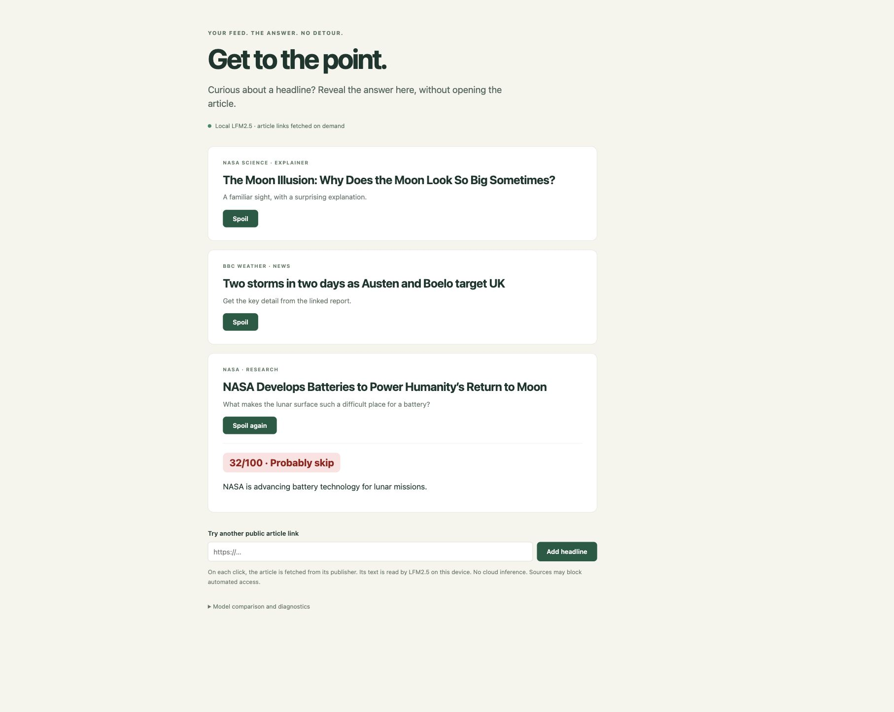

# Get to the Point

**Skip the clickbait. Find the answer. Keep inference on your laptop.**



Get to the Point is a Chrome extension and local AI service that helps you decide which articles deserve your time. Click **Spoil** beside a headline to reveal a source passage and a simple reading-value score without leaving your search results or feed.

Built for the Moonfire on-device AI challenge with **LiquidAI LFM2.5-1.2B**, **Ollama**, and a **Halo** fine-tuning pipeline.

*Actual app screenshot: a live NASA article result from the local LFM service.*

## What it does

- **Reveals the answer inline.** Fetches a public article and lets the local model select a sentence from its text, with surrounding source context.
- **Helps you choose what to read.** Shows a red, amber, or green reading-value score and a short explanation.
- **Handles blocked publishers.** Falls back to a clearly labelled preview using the headline, URL, and available search snippet, or reads the visible article when you explicitly request it.
- **Runs inference locally.** Uses a 1.2B-parameter model on your laptop. Fetching a new article still requires internet access.

The current demo uses the original LFM model. Reading-value scores use conservative content signals; they are estimates, not verified quality judgments. Source extraction prevents invented quotations, but a selected passage can still miss the headline's answer.

## Run it locally

Requires Python 3.9+, [Ollama](https://ollama.com), and Chrome for the extension.

```sh
git clone https://github.com/mashathepotato/on-device-agent.git
cd on-device-agent
python3 -m venv .venv
.venv/bin/pip install -r requirements.txt
ollama pull hf.co/LiquidAI/LFM2.5-1.2B-Instruct-GGUF:Q4_K_M
.venv/bin/python -m spoiler.server
```

Open **http://127.0.0.1:8765** to try the standalone feed. To use it on search results, open `chrome://extensions`, enable **Developer mode**, choose **Load unpacked**, and select this repository's `extension/` folder. Refresh your search page, then click **Spoil** beside a headline.

The server binds to loopback. Article retrieval sends requests to publishers; model inference stays on-device. Publisher blocks, paywalls, and unavailable article text can limit results.

## Training and results

We completed a full BF16 fine-tuning run of LFM2.5-1.2B with Halo on an NVIDIA H200: 512 training examples, 100 validation examples, two epochs, and 128 optimizer steps. Validation loss decreased from **0.324 to 0.307**. Training targets combine human Webis spoiler annotations with synthetic teacher scores.

The trained checkpoint is retained separately from Git. A matched baseline-versus-fine-tuned generation benchmark is still pending, so the project does not claim a measured quality improvement. The current demo uses the original model with the latest preview-scoring fixes.

See the [training handoff](context/handoffs/codex/lfm-score-training.md), [preview scoring notes](docs/notes/codex/preview-signal-scoring.md), and [two-slide presentation](results/lfm-presentation-table.html). The presentation's fine-tuned ranges are projections.

## Project layout

| Directory | Purpose |
| --- | --- |
| `extension/` | Chrome extension and inline result cards |
| `spoiler/` | Local API, article retrieval, and model inference |
| `web/` | Standalone browser demo |
| `training/` | Halo training and model export tooling |
| `tools/` | Data preparation and evaluation |
| `tests/` | Local checks |

For detailed installation and retrieval behavior, see [the setup guide](docs/SPOILER.md). Its earlier experiment notes are historical; the training handoff above records the latest run.

## Development

```sh
python3 -m unittest discover -s tests -v
node --check web/app.js
node --check extension/background.js
node --check extension/content.js
node --check extension/popup.js
```

Read [AGENTS.md](AGENTS.md) and [CONTRIBUTING.md](CONTRIBUTING.md) before contributing. CI is disabled; checks run locally.

Built from [Agent Team Starter](https://github.com/mashathepotato/agent-team-starter). The starter's [MIT license](LICENSE) is retained; models and datasets have their own terms.
